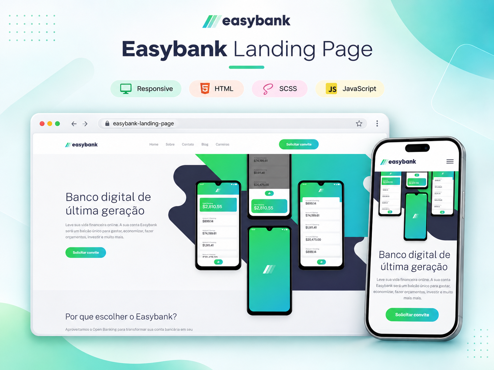

<div align="center">

  

  # Easybank Landing Page

  **A responsive fintech landing page built as a Frontend Mentor challenge, with content adapted into Brazilian Portuguese.**

  [**Live Demo**](https://gustavovitors.github.io/Easybank-landing-page/) · [**Source Code**](https://github.com/GustavoVitorS/Easybank-landing-page) · [**PT-BR Challenge Collection**](https://github.com/GustavoVitorS/Frontend-mentor-challenges_PT-BR)

  
  
  
  
  

</div>

---

## Overview

**Easybank Landing Page** is my implementation of the [Frontend Mentor](https://www.frontendmentor.io/) Easybank landing page challenge. It focuses on recreating a modern, responsive marketing interface using semantic HTML, Sass/SCSS, and vanilla JavaScript.

The website's visible copy was adapted into **Brazilian Portuguese (PT-BR)** while retaining the visual identity and general structure of the challenge. This repository showcases front-end layout development rather than a functioning banking service.

> **Project status:** This README documents the existing implementation. The showcase graphic presents the desktop and mobile layouts; it does not represent a new UI version or additional functionality.

## Live Preview

**[Open the deployed website](https://gustavovitors.github.io/Easybank-landing-page/)**

The showcase at the top of this README displays the current project in desktop and mobile presentations. It is a documentation graphic based on the existing interface, not a separate redesign.

## Features

- **Responsive layouts** designed for desktop and mobile screens.
- **Mobile navigation** with a hamburger menu, close icon, and backdrop overlay.
- **Hero section** featuring Easybank's branding, promotional content, and phone mockups.
- **Benefits section** highlighting the bank's proposed features.
- **Latest articles section** with illustrated editorial cards.
- **Footer** with navigation and social media icons.
- **Brazilian Portuguese content**, retaining certain short labels such as “Home” and “Blog” from the implementation.

> **Note:** The landing page is a front-end challenge. Promotional buttons and other placeholder links are not connected to real banking or account-registration services.

## Technologies

| Technology | Usage |
| :--- | :--- |
| **HTML5** | Page structure and semantic content |
| **SCSS / Sass** | Modular styles, variables, mixins, and responsive layout rules |
| **CSS3** | Browser-ready compiled styles and visual effects |
| **JavaScript (vanilla)** | Interactive mobile navigation and menu state |

No JavaScript framework is required to run the deployed page.

## Project Structure

```text
Easybank-landing-page/
├── css/                    # Compiled styles
├── docs/
│   └── easybank-showcase.png  # README showcase image
├── images/                 # Logos, illustrations, and icons
├── js/
│   └── script.js           # Mobile navigation interactions
├── sass/
│   ├── abstracts/          # Variables and mixins
│   ├── base/               # Reset, typography, animations
│   ├── components/         # Buttons, cards, icons, features
│   ├── layout/             # Header, navigation, hero, sections, footer
│   └── main.scss           # Sass entry point
├── index.html              # Main page
└── README.md               # Project documentation
```

## Run Locally

Clone the repository:

```bash
git clone https://github.com/GustavoVitorS/Easybank-landing-page.git
cd Easybank-landing-page
```

Open `index.html` in your browser, or serve the repository with a local HTTP server:

```bash
python3 -m http.server 8000
```

Then visit **http://localhost:8000**.

The repository already contains compiled CSS, so installing dependencies is **not** necessary to preview the page. If you change the SCSS files, you can regenerate the compressed stylesheet using the Sass CLI:

```bash
sass sass/main.scss css/main.min.css --style=compressed
```

*The last command requires Sass to be installed separately.*

## What I Practiced

- Translating and adapting interface content to **PT-BR**.
- Building responsive page layouts with Sass/SCSS.
- Structuring reusable styling rules across partial files.
- Handling mobile navigation states with vanilla JavaScript.
- Reproducing a supplied design while considering desktop and mobile presentation.

## Credits

- **Original challenge and design:** [Frontend Mentor](https://www.frontendmentor.io/)
- **Implementation and PT-BR adaptation:** [Gustavo Vitor de Souza](https://github.com/GustavoVitorS)
- **Documentation showcase:** Presentation artwork based on screenshots of this implementation.

This repository is an educational front-end project. Easybank branding and design assets are used in the context of the original challenge.

---

<div align="center">

  **More projects:** [Frontend Mentor Challenges — PT-BR](https://github.com/GustavoVitorS/Frontend-mentor-challenges_PT-BR)

  Made with HTML, SCSS, and JavaScript.

</div>
